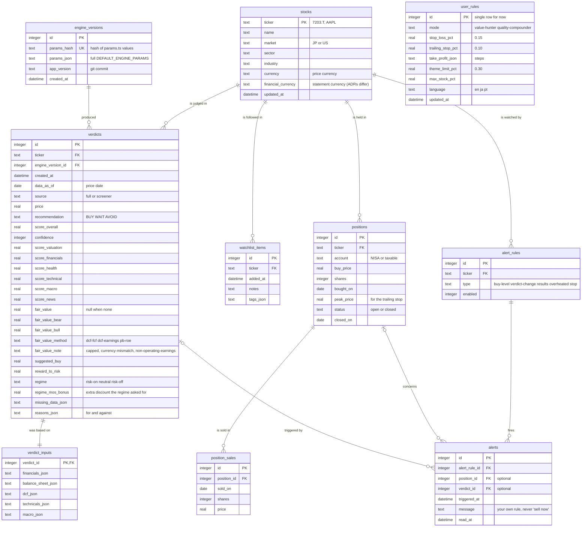

# KabuCheck database (ER diagram)

> Status: **approved by the owner 2026-11-19** (§3). Step-5 tables **built** in `src/lib/db/` (not yet called by the routes). Rules as built: CALCULATIONS.md §8.
> Engine: SQLite (one file in the project, no server), behind a small TypeScript interface so it can move to a hosted database (e.g. Postgres) when sign-in and multiple devices arrive. ENGINE_SPEC §10.3 step 5.

## 1. Diagram

**Step 5 builds the four tables at the top** (verdict log). The rest is drawn now so the structure won't need to change later; it is built with the watchlist, alerts and position features.

`user_rules` has no relations yet: there is one user. With sign-in, a `users` table arrives and `user_id` is added to `user_rules`, `watchlist_items`, `positions` and `alert_rules`.

### Research tables (added 2026-11-23)

| Table | Columns | Purpose |
|---|---|---|
| `company_research` | id, ticker, researched_at, model, research_json, cost_usd | Saved AI research per stock (CALCULATIONS §9); the newest is reused for 7 days |
| `api_usage` | id, at, purpose, ticker, model, input_tokens, output_tokens, web_searches, cost_usd, ok | Every paid API call, successful or not, for the budget guard and cost history |

`verdict_inputs` also has `research_json`: the research a verdict used.

## 2. Why it looks like this

| Choice | Reason |
|---|---|
| **Verdicts are never updated, only added** | The log is a decision journal (ENGINE_SPEC §10, principle 7): each verdict must stay exactly as it was, so it can be judged on what was known at the time. |
| **`engine_versions` table** | Each verdict records which parameter set produced it. When params change, old verdicts still say which rules they followed, and the backtest can compare versions. |
| **Inputs in a separate table (`verdict_inputs`)** | The raw data (financials, DCF, macro) is large and rarely read. Keeping it apart keeps the main log fast for lists and charts, while a verdict can still be re-checked or re-run later. |
| **Scores as columns, reasons as JSON** | Scores are filtered and charted (e.g. "all BUYs in October"), so they get columns. Reasons and missing data are only displayed, so JSON is enough. |
| **`source`: full or screener** | Screener verdicts are quick scores (no news, no price history). Both are useful, but must never be mixed up in the forward test. |
| **`account` on positions** | Owner decision §9.6.2: NISA first, taxable above the limit; tax effects apply only to the taxable part. |
| **`peak_price` on positions** | The trailing stop (the last part of the exit plan, §10.4.2) needs the highest price since buying. |

Indexes: `verdicts (ticker, created_at)` for "latest verdict per stock" (needed by hysteresis, ENGINE_SPEC §5) and `verdicts (created_at, recommendation)` for the monthly forward test against TOPIX.

## 3. Owner decisions (approved 2026-11-19)

1. **Approved:** step-5 tables `stocks`, `engine_versions`, `verdicts`, `verdict_inputs`.
2. **Log screener results too: yes**, with `source = screener`. Each scan then records the whole Nikkei list, which is the best data for the forward test (what did the model say about every stock, not only the ones you opened).
3. **Keep raw inputs: yes**, for now. At roughly 20–50 KB per verdict, even 100 verdicts a day is under 2 GB a year; revisit if it grows.
4. **File:** `data/kabucheck.db`, excluded from git (personal data and large).
