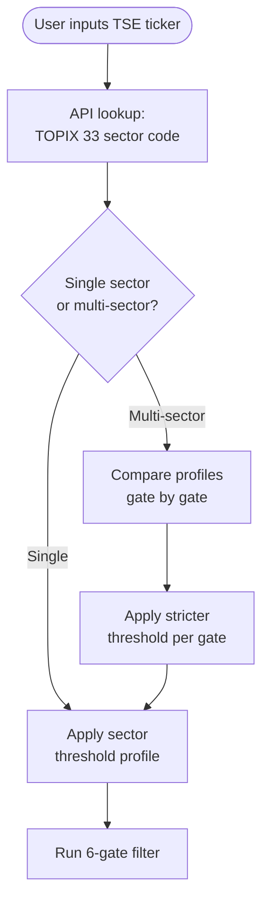
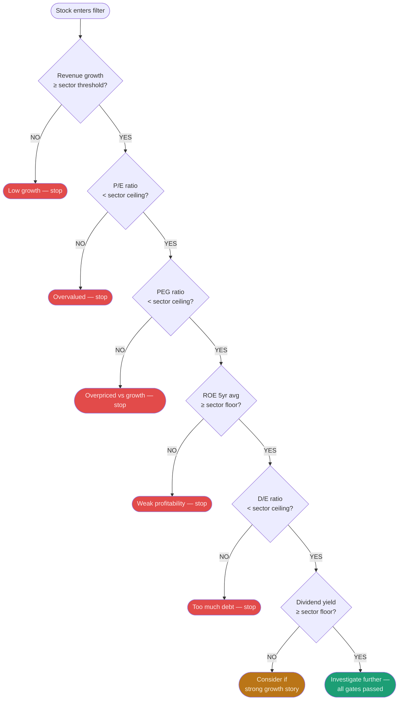

# Investment App — Master Parameter Reference

> **Purpose:** This document defines all parameters the AI agent should evaluate, calculate, and surface for users. Organized by module. Each parameter is tagged with its status and data requirements.
>
> **Status tags:** `[CORE]` = must-have | `[NEEDS-LIVE-DATA]` = requires API feed | `[SUGGESTED]` = recommended addition | `[CRITICAL-GAP]` = missing, high priority

---

## Module 1 — Stock Screener
*Source: Goldman Sachs prompt*
*Goal: Filter and rank candidate stocks based on fundamental and technical signals.*

### User inputs required
- Sector preference (or "all sectors")
- Market cap range (small / mid / large)
- Dividend preference (yes / no)
- Growth vs value orientation

### Parameters

| Parameter | Status | Notes |
|---|---|---|
| P/E ratio vs sector average | `[CORE]` | Compare to sector median, not market average |
| Revenue growth (5yr CAGR) | `[CORE]` | Compound annual growth rate preferred over raw YoY |
| Debt-to-equity ratio | `[CORE]` | Flag anything above 2.0 as elevated risk |
| Dividend yield + payout ratio | `[CORE]` | Payout ratio above 80% is unsustainable warning |
| Competitive moat rating | `[CORE]` | Qualitative: weak / moderate / strong — sourced or AI-reasoned |
| EPS growth trend | `[CORE]` | At minimum 3yr; 5yr preferred |
| Free cash flow (FCF) | `[CORE]` | More reliable than net income alone |
| Return on equity (ROE) | `[CORE]` | Above 15% generally strong; compare to sector |
| Insider ownership % | `[CORE]` | Higher = more alignment with shareholders |
| Earnings surprise history | `[CORE]` | Consistent beats signal management credibility |
| Bull / bear price targets (12mo) | `[NEEDS-LIVE-DATA]` | Pull from analyst consensus (e.g. Yahoo Finance, Benzinga) |
| Entry price zone + stop-loss | `[NEEDS-LIVE-DATA]` | Derived from support/resistance levels; requires real-time pricing |
| Risk rating 1–10 | `[NEEDS-LIVE-DATA]` | Must be calculated from beta, vol, debt, liquidity — not arbitrary |
| Institutional ownership change | `[NEEDS-LIVE-DATA]` | 13F filings; look for smart money entering or exiting |
| RSI (relative strength index) | `[NEEDS-LIVE-DATA]` | 14-day default; flag overbought (>70) / oversold (<30) |
| 52-week price position | `[NEEDS-LIVE-DATA]` | Where current price sits relative to 52-week high/low |

---

## Module 2 — DCF Valuation
*Source: Morgan Stanley prompt*
*Goal: Build a discounted cash flow model to estimate intrinsic value and compare to market price.*

### User inputs required
- Target company ticker
- Growth assumption override (optional — default to analyst consensus)
- WACC override (optional — default to calculated value)

### Parameters

| Parameter | Status | Notes |
|---|---|---|
| 5-year revenue projections | `[CORE]` | Use analyst consensus as baseline; allow manual override |
| Operating margin estimates | `[CORE]` | Pull from historical income statements; flag margin compression trends |
| Free cash flow (year-by-year) | `[CORE]` | FCF = Operating CF minus CapEx |
| CapEx assumptions | `[CORE]` | Required input to calculate FCF — missing from original prompt |
| Working capital changes | `[CORE]` | Affects actual cash generation year-to-year |
| Tax rate assumptions | `[CORE]` | Use effective tax rate from filings, not statutory rate |
| Terminal value | `[CRITICAL-GAP]` | Typically 60–80% of total DCF value — must not be omitted |
| Terminal growth rate | `[CRITICAL-GAP]` | Hard-code default at 2.5%; allow override between 1–4% |
| Net debt adjustment | `[CRITICAL-GAP]` | Enterprise value minus net debt = equity value |
| Shares outstanding | `[CRITICAL-GAP]` | Diluted share count to convert equity value → price per share |
| WACC estimate | `[NEEDS-LIVE-DATA]` | Requires: risk-free rate (10yr treasury), beta, equity risk premium, cost of debt |
| Sensitivity table | `[CORE]` | Show fair value across WACC range (±2%) and growth range (±2%) — always present as a range, never a single number |
| DCF value vs current market price | `[NEEDS-LIVE-DATA]` | Final output: upside/downside % to intrinsic value |
| Comparable company multiples (comps) | `[SUGGESTED]` | Cross-check DCF with EV/EBITDA and P/E of peer group |

---

## Module 3 — Portfolio Risk Assessment
*Source: Bridgewater prompt*
*Goal: Evaluate risk, concentration, and exposure across a user's full portfolio.*

### User inputs required
- Full holdings list (ticker + quantity or $ value)
- Account type (401k / IRA / taxable)
- Investment horizon

### Parameters

| Parameter | Status | Notes |
|---|---|---|
| Correlation analysis between holdings | `[CORE]` | Flag pairs above 0.85 correlation as redundant |
| Sector concentration risk | `[CORE]` | % per GICS sector; flag any sector above 30% |
| Geographic + currency exposure | `[CORE]` | % in USD vs non-USD; flag unhedged FX risk |
| Interest rate sensitivity | `[CORE]` | Duration for bonds; rate sensitivity for rate-sensitive equities (REITs, utilities) |
| Recession stress test | `[CORE]` | Estimated portfolio drawdown in 2008-style and 2020-style scenarios |
| Liquidity risk rating per holding | `[CORE]` | Average daily volume vs position size; flag illiquid positions |
| Single stock concentration risk | `[CORE]` | Flag any single position above 10% of portfolio |
| Position sizing recommendations | `[CORE]` | Based on volatility and correlation-adjusted weight |
| Tail risk scenarios | `[CORE]` | At minimum: rate shock, credit crisis, dollar collapse, sector collapse |
| Hedging strategies | `[CORE]` | Specific to top 3 identified risks — include instrument type (puts, inverse ETFs, gold, etc.) |
| Rebalancing suggestions | `[CORE]` | Target allocation % with drift thresholds |
| Beta per holding | `[CRITICAL-GAP]` | Market sensitivity — required for stress tests and VaR |
| Value at Risk (VaR) | `[CRITICAL-GAP]` | 95% and 99% confidence; show 1-day and 1-month horizon |
| Sharpe ratio / Sortino ratio | `[CRITICAL-GAP]` | Risk-adjusted return; Sortino preferred (penalizes downside vol only) |
| Max drawdown (historical) | `[SUGGESTED]` | Worst peak-to-trough for each holding and full portfolio |
| Inflation sensitivity | `[SUGGESTED]` | How holdings perform in high-CPI regimes — relevant for TIPS, commodities, real assets |
| Realized vs implied volatility | `[SUGGESTED]` | Historical vol vs options market expectation (IV) |
| Credit risk exposure | `[SUGGESTED]` | For any bond holdings — credit rating distribution |
| Macro factor correlations | `[SUGGESTED]` | Sensitivity to: crude oil, 10yr yield, DXY (dollar index), VIX |

---

## Module 4 — Portfolio Builder
*Source: BlackRock prompt*
*Goal: Build a personalized multi-asset portfolio from scratch based on user profile.*

### User inputs required (collect before building — this module fails without these)
- Age
- Annual income
- Total savings / investable assets
- Investment goal (retirement / wealth building / income / preservation)
- Time horizon (years)
- Risk tolerance (conservative / moderate / aggressive)
- Account type (401k / IRA / taxable / combination)
- Monthly contribution amount (for DCA plan)

### Parameters

| Parameter | Status | Notes |
|---|---|---|
| Asset allocation % | `[CORE]` | Stocks / bonds / alternatives / cash — driven by risk profile and time horizon |
| ETF / fund recommendations | `[CORE]` | Specific tickers per category; always include expense ratio |
| Core vs satellite position labels | `[CORE]` | Core = 70–80% low-cost index; satellite = tactical tilts |
| Expected annual return range | `[CORE]` | Present as range (e.g. 6–9%), never a single number |
| Expected max drawdown | `[CORE]` | Worst-case bad year based on historical allocation data |
| Rebalancing schedule + drift triggers | `[CORE]` | Calendar (annual/quarterly) + threshold (5% drift rule) |
| Tax efficiency strategy | `[CORE]` | Asset location rules: bonds in tax-advantaged, equities in taxable |
| Dollar cost averaging plan | `[CORE]` | Monthly contribution split across holdings |
| Investment policy statement | `[CORE]` | One-page rules document: goals, allocation, rebalancing rules, what triggers a review |
| User risk profile inputs | `[CRITICAL-GAP]` | Must be the first screen — all outputs depend on this |
| Expense ratio comparison | `[CRITICAL-GAP]` | Show total weighted portfolio cost drag; flag anything above 0.20% for index funds |
| Tax-loss harvesting rules | `[CRITICAL-GAP]` | Specific logic: when to harvest, wash-sale 30-day rule, how to reinvest proceeds |
| International vs domestic split | `[SUGGESTED]` | % in US / developed international / emerging markets |
| Factor tilts | `[SUGGESTED]` | Value, growth, quality, low-vol, momentum — explain trade-offs |
| Alternative assets | `[SUGGESTED]` | REITs, commodities, TIPS as inflation hedge options |
| Glide path logic | `[SUGGESTED]` | How allocation shifts as user ages or approaches goal date |
| Liquidity reserve check | `[SUGGESTED]` | Confirm 3–6 month emergency fund exists before investing |
| Macro regime awareness | `[SUGGESTED]` | Replace vague "WEF themes" with: yield curve shape, PMI, credit spreads as regime signal |

---

## Module 5 — Japan Stock Filter (TSE / TOPIX Sector-Aware)
*Goal: Screen Japanese equities using sector-calibrated thresholds derived from TOPIX 33 industry codes.*

### How it works
1. User inputs a TSE ticker (e.g. `7011`)
2. Agent auto-detects TOPIX 33 sector from the ticker via API
3. Agent maps sector → threshold profile (see table below)
4. If stock spans multiple sectors, **always apply the stricter profile**
5. Stock runs through 6 sequential gates — fail any gate = stop

### Sector threshold profiles

| Sector | Revenue growth | P/E ceiling | PEG ceiling | ROE floor | D/E ceiling | Dividend floor |
|---|---|---|---|---|---|---|
| Defense | ≥ 5% | < 25 | < 2.0 | ≥ 8% | < 0.8 | ≥ 1.0% |
| Auto / Manufacturing | ≥ 3% | < 15 | < 1.8 | ≥ 8% | < 0.6 | ≥ 2.0% |
| Tech / Semiconductors | ≥ 10% | < 30 | < 2.5 | ≥ 12% | < 0.4 | ≥ 0.5% |
| Pharma / Healthcare | ≥ 7% | < 28 | < 2.2 | ≥ 10% | < 0.3 | ≥ 1.0% |
| Banking / Financial | ≥ 3% | < 12 | < 1.5 | ≥ 6% | Tier 1 > 12%* | ≥ 2.5% |
| Trading / Conglomerate | ≥ 4% | < 14 | < 1.8 | ≥ 8% | < 1.0 | ≥ 2.5% |
| Consumer / Retail | ≥ 5% | < 20 | < 2.0 | ≥ 10% | < 0.5 | ≥ 1.5% |
| Energy / Utilities | ≥ 2% | < 14 | < 1.5 | ≥ 6% | < 1.2 | ≥ 3.0% |
| Real Estate | ≥ 3% | < 20 | < 1.8 | ≥ 6% | < 2.0 | ≥ 3.0% |
| Telecom | ≥ 2% | < 15 | < 1.8 | ≥ 8% | < 1.0 | ≥ 3.0% |

*D/E is not meaningful for banks — use Tier 1 capital ratio instead.

### Multi-sector rule
When a stock operates across multiple TOPIX sectors (e.g. Toyota = auto + tech), apply the profile that is hardest to pass across each gate. Never average thresholds — always take the stricter value gate-by-gate.

### Detection flow



### 6-gate filter logic



### Agent instructions for this module
- **Always show which profile was applied** and why (single-sector vs multi-sector stricter rule)
- **Always show which gate failed** and the actual value vs threshold, not just "failed"
- **Flag net-cash companies** (D/E = 0 or negative net debt) as a positive signal — common and desirable in Japan
- **Banking stocks:** skip D/E gate entirely; substitute Tier 1 capital ratio check
- **Data source for TOPIX sector codes:** JPX official data feed, or Refinitiv/Bloomberg sector field; fallback to Financial Modeling Prep `profile` endpoint which carries TSE industry classification

---

## Module 6 — Margin Risk
*Motivation: KOSPI Black Monday (June–July 2026)*
*Goal: Detect when leveraged retail debt has built up to a level where a cascade liquidation is possible. This is a systemic risk signal that sits above individual stock analysis — it affects the macro environment score and should suppress BUY verdicts when triggered.*

### What happened — the KOSPI margin cascade (June–July 2026)

The KOSPI doubled in H1 2026, driven almost entirely by Samsung Electronics and SK Hynix (together ~50% of KOSPI market cap). That rally sucked in enormous retail leverage. In May 2026, margin loan balances surpassed 60 trillion won — an all-time record — and 2× leveraged ETF products sold out immediately upon listing.

The trigger: the Bank of Korea raised its policy rate by 25bps on July 16 (first hike in three years, 2.5% → 2.75%). On July 28, reports emerged that China had begun mass-producing self-developed deep ultraviolet lithography machines, dealing a severe blow to Korea's semiconductor outlook. The next day, SK Hynix reported record earnings that fell short of lofty expectations — panic selling began.

Margin loan balances had peaked at ₩38.63 trillion on June 24 then fell to ₩34.37 trillion by July 15 — not a managed deleveraging but a forced one. Over 1.2 million leveraged accounts hit margin call thresholds; approximately 360,000 were forcibly liquidated by brokers. The forced liquidation ratio surged from 2.1% (6-month average) to above 10%. Each liquidation put pressure on prices → more margin calls → more forced selling → more pressure. Circuit breakers fired on two consecutive days. Total market value erased: approximately ₩864.5 trillion (~$608.7 billion) over two sessions.

### Parameters

| Parameter | Status | Warning threshold | What KOSPI showed |
|---|---|---|---|
| Market-wide margin loan balance | `[NEEDS-LIVE-DATA]` | Growing faster than underlying index | ₩60T won before crash |
| Margin loan 90-day growth rate | `[NEEDS-LIVE-DATA]` | Above 20% in 90 days = danger | Surged 30%+ in under 3 months |
| Forced liquidation ratio | `[NEEDS-LIVE-DATA]` | Above 3% of outstanding = systemic warning | Spiked from 2.1% → 10.2% in days |
| Leveraged ETF share of daily volume | `[NEEDS-LIVE-DATA]` | Above 15% of daily volume = distortion risk | Single-stock leveraged ETFs dominated |
| Margin concentration in top stocks | `[NEEDS-LIVE-DATA]` | Top 4 stocks > 50% of total margin debt | Samsung + SK Hynix were the locus |
| Individual stock margin debt vs free float | `[NEEDS-LIVE-DATA]` | Flag if margin debt > 5% of free float | Both dominated stocks exceeded this |
| Rate environment change | `[CORE]` | First central bank hike in a hiking cycle | BoK hike 2.5% → 2.75% was the pin |
| Circuit breaker frequency | `[NEEDS-LIVE-DATA]` | More than 5/year = systemic stress | 35 sell-side sidecars + 7 circuit breakers by late June — exceeding 2008's full-year record |

### Ideal numbers to surface to users

- **Stock-level:** Flag any stock where margin debt exceeds **5% of its free float**
- **Market-level:** Flag the market if total margin loans grew more than **20% in 90 days**
- **Daily signal:** Show the forced liquidation ratio — above **3%** is a systemic warning; above **7%** is critical
- **Concentration flag:** If a single stock represents more than **20% of total market margin debt**, label it "margin concentration risk"
- **Verdict suppression:** When market-wide forced liquidation ratio is above 3% AND rate environment is tightening, downgrade all BUY verdicts to WAIT until the ratio normalizes

### How this integrates into the verdict engine

```
Margin Risk Score (0–10):
  Base: 5 (neutral)
  + 3 if forced liquidation ratio < 2% AND margin growth < 10%/90d  → benign
  - 2 if forced liquidation ratio 3–7%                               → elevated
  - 4 if forced liquidation ratio > 7%                               → critical
  - 2 if total margin loans grew > 20% in 90 days                   → frothy
  - 1 if central bank is in active hiking cycle                      → rate risk
  - 1 if leveraged ETF volume > 15% of daily market volume           → speculation
  min: 0, max: 10

When Margin Risk Score < 3: suppress all BUY verdicts → force to WAIT
When Margin Risk Score < 2: suppress all BUY and WAIT verdicts → force to AVOID
```

### Data sources for this module

| Data point | Source |
|---|---|
| KOSPI/TSE/NYSE margin loan balances | KRX (Korea), JPX (Japan), FINRA (US — monthly margin stats) |
| Forced liquidation ratio | KRX daily margin statistics; equivalent from TSE for Japan |
| Leveraged ETF volume data | Exchange daily volume feeds |
| Individual stock margin debt | FINRA Reg T data (US); KRX margin balance by issue (KR); TSE margin trading data (JP) |

> **Note:** Market-wide margin data is typically available with a 1–2 day lag for US (FINRA), same-day for KR and JP exchanges. This module affects the macro score layer, not the individual stock scoring layer.

---

## Data Sources — Recommended APIs

| Data type | Recommended source |
|---|---|
| Real-time + historical prices | Polygon.io, Alpha Vantage, Yahoo Finance (yfinance) |
| Fundamentals (P/E, revenue, FCF, etc.) | Financialmodelingprep.com, Macrotrends, SimFin |
| Analyst estimates + price targets | Benzinga, Tipranks, Yahoo Finance |
| ETF data + expense ratios | ETFdb.com, iShares, Vanguard APIs |
| Macro data (yields, CPI, PMI) | FRED (Federal Reserve), BLS, ISM |
| Insider + institutional filings | SEC EDGAR (13F, Form 4) |
| Options / implied volatility | CBOE, Unusual Whales, Tradier |

---

## Agent Instructions

- **Treat margin cascade risk as a macro override.** When the forced liquidation ratio exceeds 3%, it is not a stock-specific signal — it suppresses the entire market's BUY verdicts. Individual company quality is irrelevant if a margin cascade is in progress.
- **Always present ranges, not point estimates.** Return ranges are uncertain — show scenarios.
- **Never fabricate data.** If a data point is unavailable from the API, say so explicitly.
- **Collect user profile before Module 4.** Portfolio builder output is invalid without age, horizon, and risk tolerance.
- **Flag data freshness.** Always show the date of the last data pull for any financial metric.
- **Sensitivity tables over single outputs.** Especially for DCF — always show how the answer changes with assumptions.
- **Prioritize FCF over earnings.** Earnings can be manipulated; free cash flow is harder to fake.
- **Risk-adjust everything.** A 20% return with 40% volatility is worse than a 12% return with 10% volatility.